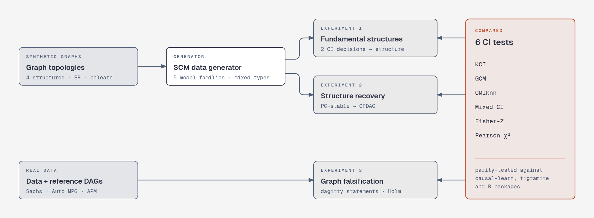

# causal-ci-benchmark

Benchmark of conditional independence (CI) tests for causal discovery on continuous, categorical
and mixed data. Six CI tests are implemented from their papers, checked for parity against
reference implementations, and compared in three experiments: recovering the four fundamental
causal structures, recovering whole graphs with the PC algorithm, and falsifying reference graphs
on real data.

Code of my Bachelor's thesis (TFG) for the Double Degree in Computer Science and Mathematics at the
University of Granada.



## Contents

- [CI tests](#ci-tests)
- [Experiments and results](#experiments-and-results)
- [Installation](#installation)
- [Usage](#usage)
- [Repository structure](#repository-structure)
- [Data sources](#data-sources)
- [Development](#development)

## CI tests

Every test takes a `pandas.DataFrame` and the names of `x`, `y` and the conditioning set `z`, and
returns a common `CIResult` (statistic and p-value), so any of them can be plugged into the
experiments or into causal-learn's PC through an adapter.

| Test | Method | Reference | Parity checked against |
|---|---|---|---|
| **KCI** | Kernel-based CI test | Zhang, Peters, Janzing & Schölkopf (2011) | causal-learn `KCI_CInd` / `KCI_UInd` |
| **GCM** | Generalised Covariance Measure | Shah & Peters (2020) | R package `GeneralisedCovarianceMeasure` |
| **CMIknn** | Nearest-neighbour conditional mutual information | Runge (2018), AISTATS | tigramite `CMIknn` |
| **Mixed CI** | Likelihood-ratio tests of nested regressions for mixed data | Tsagris, Borboudakis, Lagani & Tsamardinos (2018) | R package `MXM` (`ci.mm`) |
| **Fisher-Z** | Fisher's Z-transformed partial correlation | Kalisch & Bühlmann (2007), JMLR | causal-learn `FisherZ` |
| **Pearson χ²** | Pearson's chi-squared over the strata of `z` | Agresti (2002) | causal-learn `chisq` |

## Experiments and results

All experiments use α = 0.05. Results are stored as CSV in
[`src/Experiments/Results/`](src/Experiments/Results/) and every row records the commit that
produced it.

### Experiment 1: fundamental structures

Datasets are generated from the four fundamental structures (independence, direct dependence,
collider and confounder) with 5 structural causal model families (linear Gaussian, linear
non-Gaussian, additive noise, post-nonlinear and local scale), 3 mixes of variable types
(continuous, categorical, half categorical), conditioning sets of 1 to 5 variables and 500 or 1000
samples, 200 repetitions each: **120,000 datasets**. Each test decides marginal and conditional
independence, and the pair of decisions classifies the structure.

Share of datasets whose structure is classified correctly:

| CI test | Continuous | Half categorical | Categorical | Overall | Median time per dataset |
|---|---:|---:|---:|---:|---:|
| KCI | 0.840 | 0.845 | 0.836 | **0.841** | 0.88 s |
| Mixed CI | 0.685 | 0.761 | 0.864 | 0.770 | 0.05 s |
| GCM | 0.690 | 0.674 | 0.707 | 0.691 | 0.11 s |
| Fisher-Z | 0.685 | 0.673 | 0.669 | 0.676 | 0.002 s |
| Pearson χ² | 0.596 | 0.664 | 0.768 | 0.676 | 0.41 s |
| CMIknn | 0.720 | 0.635 | 0.566 | 0.640 | 5.99 s |

Raw results: `experiment_confusion.csv.xz` (720,000 rows, one per dataset and test).

### Experiment 2: structure recovery with PC

PC-stable is run with each CI test on graphs with the topology of a random Erdős–Rényi graph
(15 nodes, edge probability 0.2) or of the ASIA and SACHS bnlearn networks, under three scenarios (baseline,
heteroscedastic, nonlinear), with mixed variable types and model families, 500 or 1000 samples and
50 repetitions: **900 datasets**. The estimated CPDAG is stored next to the true graph.

Mean adjacency F1 (skeleton of the estimated CPDAG against the skeleton of the true DAG):

| CI test | Baseline | Heteroscedastic | Nonlinear |
|---|---:|---:|---:|
| KCI | 0.897 | **0.912** | **0.923** |
| Mixed CI | **0.923** | 0.847 | 0.881 |
| Pearson χ² | 0.865 | 0.872 | 0.896 |
| Fisher-Z | 0.843 | 0.725 | 0.763 |
| GCM | 0.813 | 0.709 | 0.750 |
| CMIknn | 0.693 | 0.674 | 0.691 |

Raw results: `experiment_pc.csv`.

### Experiment 3: falsifying graphs on real data

For three real datasets with a reference graph (Sachs, Auto MPG and APM), the conditional
independencies implied by the graph are listed with dagitty, one or more per pair of non-adjacent
nodes, following the cases of Eulig et al. (2025). Every CI test is run on each testable statement
(64 for Sachs, 6 for Auto MPG, 140 for APM), p-values are corrected with Holm's method, and the
robustness of each rejection is measured with multi sample splitting.

Raw results: `experiment_real.csv`, and `experiment_real_ranking.csv` with the statements ranked by
how many tests reject them robustly.

## Installation

Requirements: Python 3.12 with [uv](https://docs.astral.sh/uv/), and R 4.6 (used through `rpy2` for
the parity tests against R packages and for dagitty in experiment 3).

```bash
git clone https://github.com/manuel48265/causal-ci-benchmark.git
cd causal-ci-benchmark
uv sync                                                     # Python dependencies (uv.lock)
Rscript -e 'install.packages("renv"); renv::restore(lockfile = "renv.lock", library = .libPaths()[1], prompt = FALSE)'   # R packages
```

### Docker

The image installs Python and R dependencies from the lock files, so results can be reproduced
without a local setup. By default it runs the full check suite:

```bash
docker build -t causal-ci-benchmark .
docker run --rm causal-ci-benchmark                         # lint, type check and tests
docker run --rm -v "$PWD/src/Experiments/Results:/app/src/Experiments/Results" \
    causal-ci-benchmark make experiment1                    # write results to the host
```

`.git` is excluded from the image, so the `code_version` column is only filled when the
experiments run outside Docker.

## Usage

```bash
make test           # pytest
make check          # ruff, ruff format --check, mypy and pytest
make experiment1    # fundamental structures
make experiment2    # structure recovery with PC
make experiment3    # falsification on real data
```

The experiments use 8 worker processes by default (`make experiment1 WORKERS=1` gives the cleanest
timings). The experiments are resumable: running one again continues from the rows already in its
results file. Experiment 1 writes `experiment_confusion.csv`; decompress the committed file
first (`xz -dk src/Experiments/Results/experiment_confusion.csv.xz`) to resume from it.

Each runner also accepts its own options, for example:

```bash
uv run python -m src.Experiments.Experimental_cases.run_experiment --reps 10 --limit 100
uv run python -m src.Experiments.Experimental_cases.run_real_experiment --datasets sachs --tests kci gcm
```

## Repository structure

```text
src/
├── CI_tests/                 # the six CI tests and the common CIResult / CITest contract
│   ├── KCI/  GCM/  CMIknn/  Mixed_CI/  Fisher_Z/  pearson_chi2/
│   └── common.py
└── Experiments/
    ├── DAG_Generation/       # fundamental structures, Erdős–Rényi graphs, bnlearn topologies
    ├── Node_Generation/      # structural causal model families and node generator
    ├── Real_Data/            # Sachs, Auto MPG and APM loaders and CSV files
    ├── Experimental_cases/   # experiment runners, PC runner, dagitty bridge, multi sample splitting
    └── Results/              # CSV results of the three experiments
test/                         # pytest suite, including parity tests against the reference packages
docs/                         # README figure (pipeline.html is its source)
```

## Data sources

- **bnlearn networks** (ASIA, ALARM, INSURANCE, SACHS): `.bif` files from the
  [bnlearn Bayesian Network Repository](https://www.bnlearn.com/bnrepository/) by Marco Scutari,
  CC BY-SA 3.0. Only the graph structure is used; the data are simulated with this repository's
  generator. Sources in [`DAG_Generation/bnlearn_networks/`](src/Experiments/DAG_Generation/bnlearn_networks/README.md).
- **Real data**: the Sachs and APM data and the Auto MPG graph come from the code of E. Eulig et
  al., "Toward Falsifying Causal Graphs Using a Permutation-Based Test", AAAI 2025
  ([eeulig/dag-falsification](https://github.com/eeulig/dag-falsification), Apache 2.0); the Auto
  MPG data from the UCI Machine Learning Repository. How each file was obtained is documented in
  [`Real_Data/README.md`](src/Experiments/Real_Data/README.md).

## Development

- Type hints are mandatory (ruff `ANN` rules and strict mypy); docstrings follow numpydoc.
- `./scripts/format.sh` auto-formats; `./scripts/check.sh` (or `make check`) verifies everything
  without modifying files.
- Activate the git hooks once after cloning: `git config core.hooksPath .githooks`. The pre-commit
  hook formats staged files and the pre-push hook blocks a push if `check.sh` fails.

## Author

Manuel González Santana
